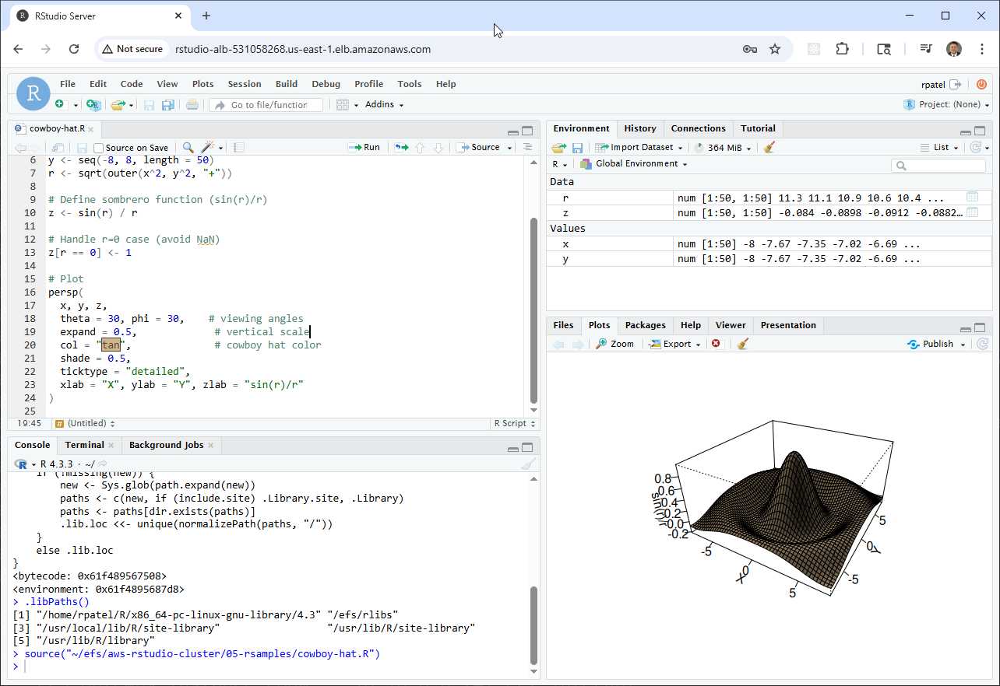
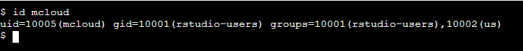

# RStudio Server Cluster on AWS: Auto Scaling, EFS and Active Directory

An **RStudio Server** cluster for shared data-science work, built on the
[AWS Mini Active Directory](https://github.com/mamonaco1973/aws-mini-ad) lab.
An **Application Load Balancer** spreads users across an **Auto Scaling
group** of RStudio nodes built from a **Packer** image; every node joins a
**mini-AD** domain, so users sign in with their AD accounts, and mounts the
same **Amazon EFS** file system for home directories, shared data and a
shared R package library. A Windows host and a Samba gateway give admins
access to the same files.



| Piece | Where | Role |
|---|---|---|
| **rstudio-alb** | public subnets | internet-facing ALB on HTTP 80; target group on 8787 with a one-day sticky cookie; health check `/` |
| **rstudio-asg** | private VM subnets | `m5.large` nodes from the RStudio AMI, 2 to 4 (desired 2), ELB health checks; a CPU alarm (above 60% for two 30-second periods) adds a node |
| **RStudio AMI** | built by Packer | Ubuntu 24.04 with R (`r-base`), RStudio Server (open source), SSSD/realmd, `amazon-efs-utils`, AWS CLI and SSM |
| **efs-samba-gateway** | public subnet | Ubuntu 24.04, `t3.medium`; joined to AD; mounts EFS and shares `/efs` over Samba |
| **windows-ad-admin** | public subnet | Windows Server, `t3.medium`; joined to AD; RSAT for managing users; maps the gateway's share as `Z:` |
| **mini-AD** | private AD subnet | [`module-aws-mini-ad`](https://github.com/mamonaco1973/module-aws-mini-ad) Samba DC for `rstudio.mikecloud.com` (`RSTUDIO`); users, groups, POSIX IDs, DNS, Kerberos |
| **rstudio-efs** | both VM subnets | encrypted EFS with a mount target in each |
| **Secrets Manager** | us-east-1 | `admin_ad_credentials_rstudio` and one `*_ad_credentials_rstudio` secret per user |
| **rstudio-vpc** | `10.0.0.0/23` | two public subnets (ALB, gateway, Windows), two private VM subnets and a private AD subnet; NAT gateway for the private ones |

## Architecture

<picture>
  <source media="(prefers-color-scheme: dark)" srcset="architecture-dark.svg">
  
</picture>

Regenerate with `python3 make_diagram.py`. The gateway and Windows host also
join the domain; those lines are left off the diagram to keep it readable.

- **`01-directory/`**: the VPC and subnets, NAT gateway, the AD passwords in
  Secrets Manager, and the mini-AD DC with users and groups from
  `scripts/users.json.template`.
- **`02-servers/`**: EFS and its mount targets, the gateway and Windows
  hosts, their IAM role and security groups.
- **`03-packer/`**: the RStudio AMI (`rstudio_ami.pkr.hcl` and its install
  scripts).
- **`04-cluster/`**: the launch template, Auto Scaling group, scaling alarm
  and policy, load balancer, and `scripts/rstudio_booter.sh`.
- **`05-rsamples/`**: sample R scripts (plots and simulations) and
  `packages.R`.
- **`06-utils/`**: `getNextUID` / `getNextGID` scripts for adding AD users.

## How a node starts

`rstudio_booter.sh` runs on every new node:

1. Mounts the EFS root as `/efs` and `/efs/home` as `/home`, both with TLS.
2. Reads the AD admin password from Secrets Manager and joins the domain
   with `realm join`; SSSD uses short names and the POSIX IDs from AD.
3. Gives `linux-admins` passwordless sudo and makes new home directories
   `0700`.
4. Writes `Rprofile.site` so every session's library path is the user's own
   library, then `/efs/rlibs`, then the system library. `/efs/rlibs` belongs
   to `rstudio-admins`, so admins install packages once for everyone and
   other users install into their own library.

Because `/home` lives on EFS, a user sees the same files whichever node the
load balancer sends them to.

## Users and groups

| User | uidNumber | Groups | Notes |
|---|---|---|---|
| jsmith | 10001 | rstudio-users, us, linux-admins, rstudio-admins, Domain Admins | sudo; writes `/efs/rlibs` |
| edavis | 10002 | rstudio-users, us | |
| rpatel | 10003 | rstudio-users, india, linux-admins, rstudio-admins, Domain Admins | sudo; writes `/efs/rlibs` |
| akumar | 10004 | rstudio-users, india | |

| Group | gidNumber |
|---|---|
| rstudio-users | 10001 (every user's primary group) |
| us | 10002 |
| india | 10003 |
| linux-admins | 10004 |
| rstudio-admins | 10005 |

Passwords are random and stored in Secrets Manager. Linux reads users and
groups through SSSD using these `uidNumber` and `gidNumber` attributes, so
they must be set on every account.

## Prerequisites

* [An AWS Account](https://aws.amazon.com/console/)
* [Install AWS CLI](https://docs.aws.amazon.com/cli/latest/userguide/getting-started-install.html)
* [Install Terraform](https://developer.hashicorp.com/terraform/install)
* [Install Packer](https://developer.hashicorp.com/packer/install)
* [Install jq](https://jqlang.github.io/jq/download/)

If this is your first time watching our content, we recommend starting with
this video: [AWS + Terraform: Easy Setup](https://youtu.be/BCMQo0CB9wk).

## Deploy

```bash
git clone https://github.com/mamonaco1973/aws-rstudio-cluster.git
cd aws-rstudio-cluster
./apply.sh
```

`apply.sh` applies `01-directory`, then `02-servers`, builds the RStudio AMI
with Packer, and applies `04-cluster`. It ends by running `validate.sh`:

```
============================================================================
RStudio AD Lab - Validation Output
============================================================================

NOTE: Windows RDP Host FQDN:       ec2-x-x-x-x.compute-1.amazonaws.com
NOTE: Linux Gateway Public:        ec2-x-x-x-x.compute-1.amazonaws.com
NOTE: RStudio ALB Endpoint:        http://rstudio-alb-123456789.us-east-1.elb.amazonaws.com
```

## Try it

1. Open the **RStudio ALB Endpoint** and sign in as one of the users above,
   with the password from its `*_ad_credentials_rstudio` secret.
2. Open a sample from `05-rsamples` and run it. The gateway clones this
   repository into `/efs`, so the samples are there on every node.
3. Add a user:
   1. RDP to `windows-ad-admin` as `jsmith` or `rpatel` and open **Active
      Directory Users and Computers** with **View > Advanced Features** on.
   2. Under the domain's **Users** container, create the user with a UPN
      such as `mcloud@rstudio.mikecloud.com` and an initial password.

      

   3. Run `Z:\aws-rstudio-cluster\06-utils\getNextUID.bat` for the next free
      `uidNumber`.
   4. In **Attribute Editor**, set `uidNumber` to that value, `gidNumber` to
      `10001`, and `uid` to the login name.
   5. Under **Member Of**, add `rstudio-users` and any other groups.
   6. From an SSM session on `efs-samba-gateway`, check the mapping with
      `id mcloud`:

      

   7. Sign in to RStudio as the new user. They can't write `/efs/rlibs`
      until they're in `rstudio-admins`.

## Teardown

```bash
./destroy.sh
```

## Notes

- **Lab only.** RStudio is served over plain HTTP, so passwords cross the
  internet unencrypted. RDP (3389), SSH (22) and SMB (445) on the Windows
  host and gateway, and port 8787 on the nodes, are open to `0.0.0.0/0`, and
  so is NFS on the EFS security group.
- The Auto Scaling group only has a scale-up policy, so it grows to 4 nodes
  under load and doesn't shrink back on its own.
- The old README listed `india` as 10002 and `us` as 10003; the template
  sets `us` to 10002 and `india` to 10003.
